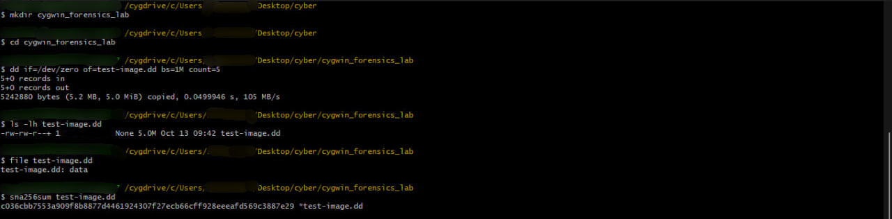
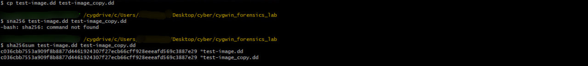
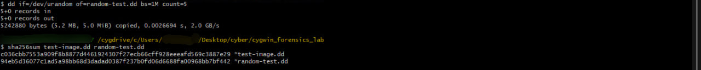

# Cygwin-disk-imaging-lab
A beginner digital forensics lab exploring disk-image creation and SHA-256 hash verification using Cygwin.

## 1. Overview

This lab explores basic digital forensics concepts using Cygwin on Windows. It demonstrates the creation of a small test image, file inspection, SHA-256 hash calculation, and integrity verification through file comparison.

## 2. Objectives

- Practise basic command-line operations relevant to digital forensics.
- Create and inspect a simulated disk-image file.
- Calculate and compare SHA-256 hashes.
- Document the procedure and findings.

## 3. Environment

- Command-line environment: Cygwin
- Date performed: 13/10/2026

## 4. Methodology

### Step 1: Creating the test image

I used `dd` with `/dev/zero` as the input source to create a small test file. The output file was named `test-image.dd`.

### Step 2: Inspecting the image

I used `ls`, and `file` to examine the file's size and type.

### Step 3: Calculating the hash

I used `sha256sum` to calculate the SHA-256 hash of the original test image.

### Step 4: Verifying a copy

I copied the original file and compared the SHA-256 hashes of both files. 

### Step 5: Testing file modification

I created a separate image file with `dev/urandom`. I compared the resulting hash with that of the first image file.

## 6. Key Findings

The first image file and copy version had the same hashes even though the names were different. This signifies the contents remain unchanged even though the names are different. 
The second image file I created had different hash when compared to the first image file.

## 7. Limitations

This exercise used a simulated file rather than acquiring data from a physical storage device. It demonstrates basic file handling and integrity verification, but does not constitute a complete forensic acquisition or investigation. 

